<div align="center">

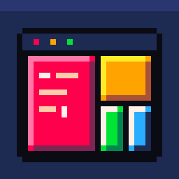

# Tessella

**A native macOS GUI for [tuios](https://github.com/Gaurav-Gosain/tuios), written in Rust.**

[](LICENSE)

[](https://www.rust-lang.org)


[Features](#features) ·
[Screenshots](#screenshots) ·
[Install](#install) ·
[Keys](#keys) ·
[Settings](#settings) ·
[Limits](#limits)

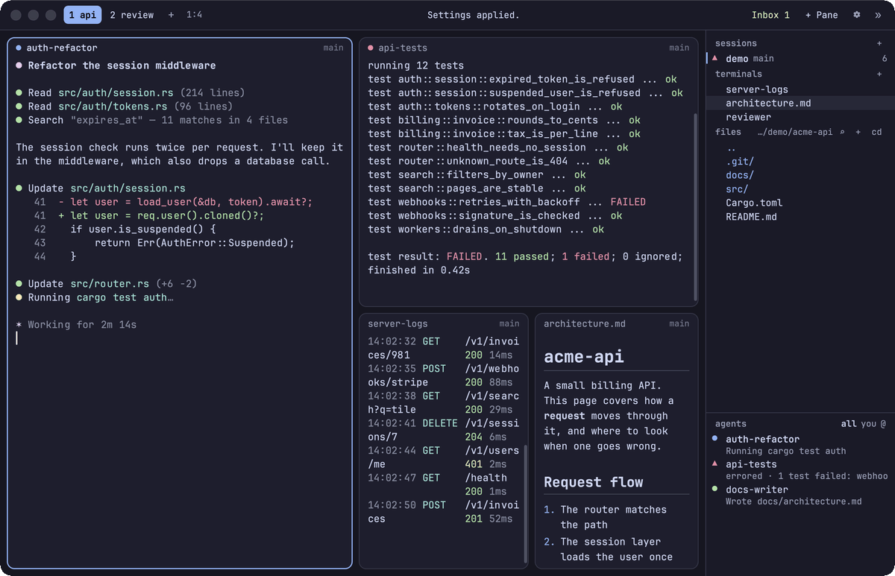

</div>

Tessella is a window onto your tuios sessions. tuios still runs your terminals, so closing
Tessella leaves them running, and your tuios keys, themes, hosts and scripts work with nothing
to set up. Tessella is an independent project, not part of tuios.

> **Early alpha.** Expect rough edges and missing pieces. It is tested with tuios 0.11.1 and 0.12.1, and it
> talks to a hidden tuios command with no stability promise, so a tuios update can break it.

## Features

| | | |
|---|---|---|
|  | **Panes and layouts** | Splits, workspaces and popups in BSP, master-stack or scrolling (niri-style) layouts, with animated zoom and saved layouts |
|  | **A real mouse** | Drag split lines to resize and headers to move panes, use the scrollbar, and select text. Programs that ask for the mouse get clicks and the wheel |
|  | **Agents at a glance** | See every agent's state in the sidebar and the Agents tab, message them, and answer `tuios ask-human` questions with a click |
|  | **Inbox and mail** | Approvals, questions, errors and mail in one list, with mail to agents on your other machines |
| 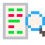 | **Review** | Read what an agent changed, leave notes on lines, and send them back to it |
|  | **File manager** | Create, rename, copy, cut, paste, trash, search and send files from the sidebar, with a right-click menu, on this machine or another |
|  | **Markdown panes** | `.md` files open rendered in a tiled pane, from any machine, and reload when the file changes |
|  | **Your keys** | Your tuios prefix and keybindings work as they are. Pause after the prefix and it shows what comes next |
| 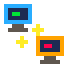 | **Other machines** | Open panes on any machine in your tuios `[hosts]`, and browse, open and move its files from the sidebar |
|  | **Themes** | Every tuios theme, with live preview and favourites, plus copy mode, a command palette and a settings window |

## Screenshots

<table>
  <tr>
    <td width="50%">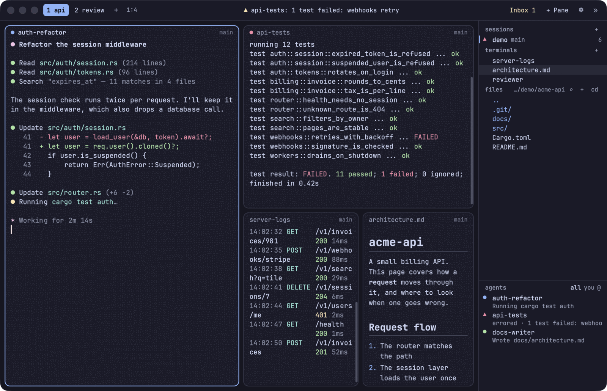<br><b>Panes and sidebar.</b> Agents, tests, logs and docs side by side.</td>
    <td width="50%">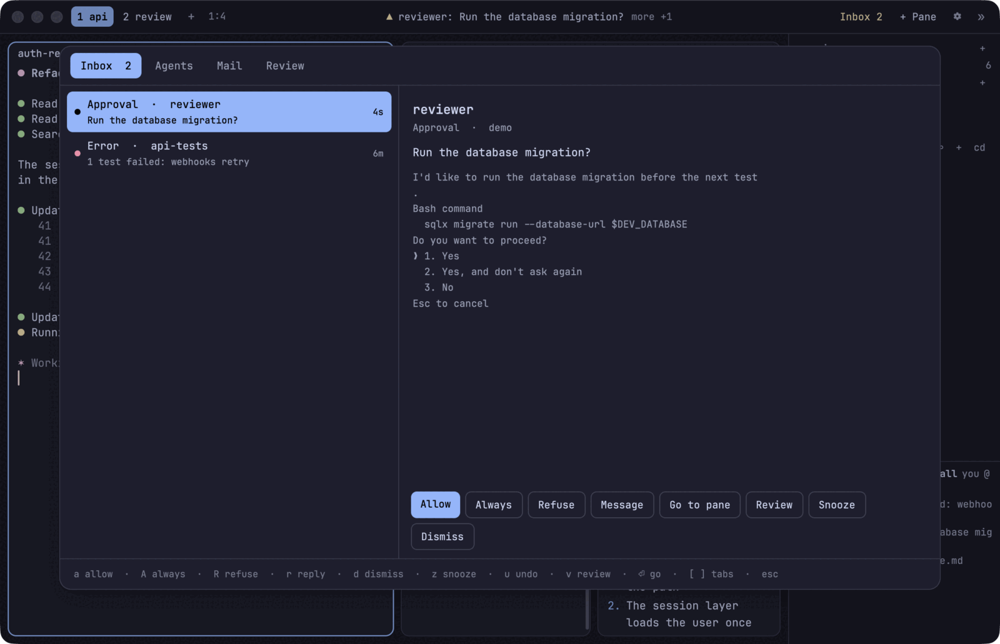<br><b>Inbox.</b> Answer a prompt without going to its pane.</td>
  </tr>
  <tr>
    <td>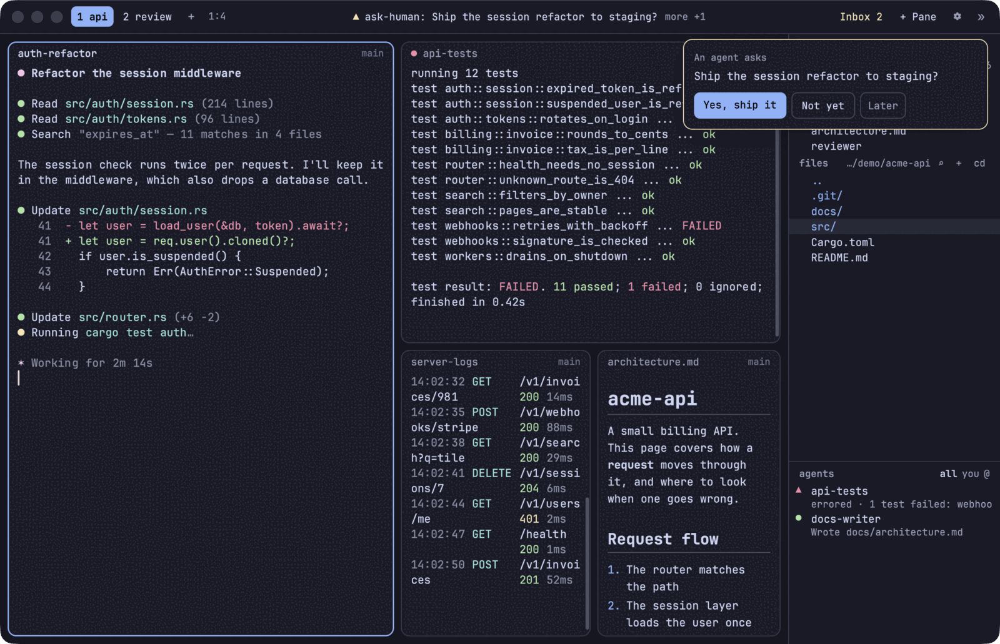<br><b>Questions.</b> <code>tuios ask-human</code> shows up as a card. It takes clicks only, so typing cannot answer it by accident.</td>
    <td>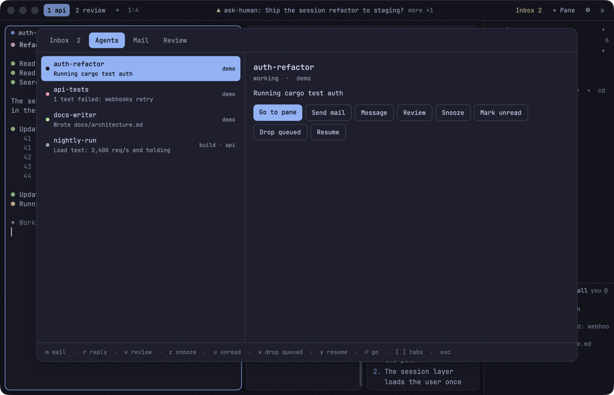<br><b>Agents.</b> Every agent here and on your other machines.</td>
  </tr>
  <tr>
    <td>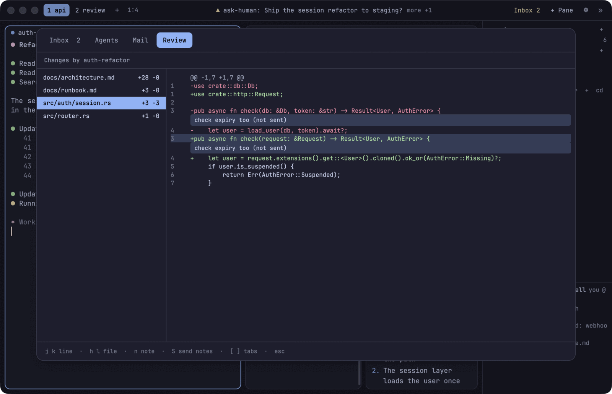<br><b>Review.</b> A diff of the agent's work, with your notes on it.</td>
    <td>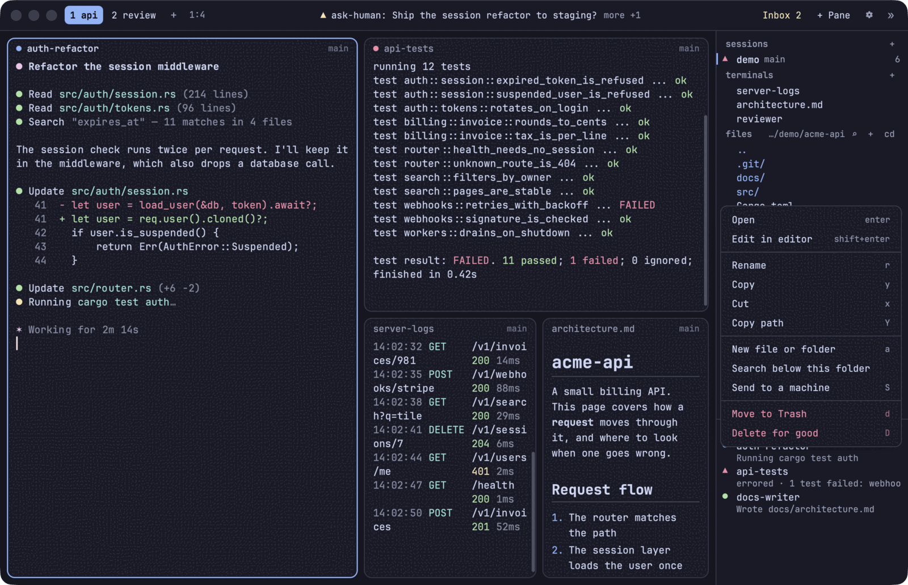<br><b>Files.</b> Right-click for a menu, or use your tuios file keys.</td>
  </tr>
  <tr>
    <td>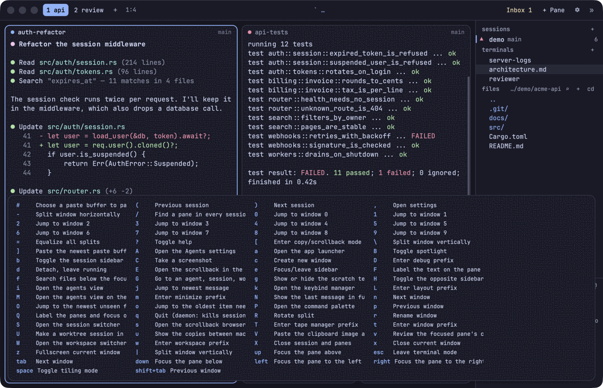<br><b>Which-key.</b> Pause after the prefix to see your keys.</td>
    <td>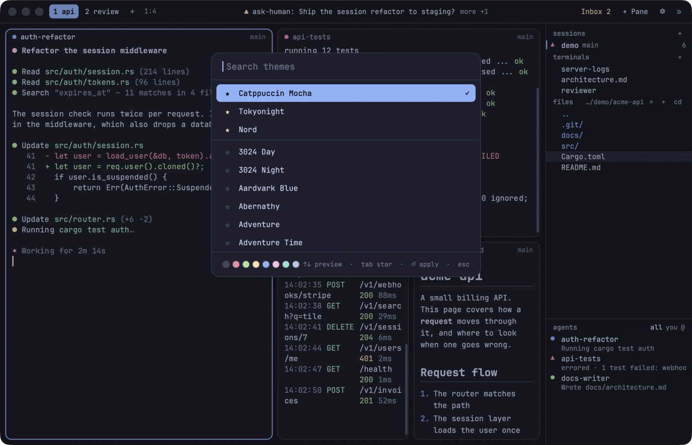<br><b>Themes.</b> Live preview, with your favourites first.</td>
  </tr>
</table>

## Install

With [Homebrew](https://brew.sh), on macOS:

```sh
brew install audiarmadhani/tap/tessella
```

This builds Tessella from source and installs tuios if you do not have it. The first build takes a
few minutes.

Or build it yourself, with [Rust](https://rustup.rs) and tuios installed:

```sh
git clone https://github.com/audiarmadhani/tessella
cd tessella
cargo build --release
./target/release/tessella
```

Tessella is tested with tuios 0.11.1 and 0.12.1.

From a clone, `scripts/try.sh` tries it without touching your live sessions. It uses a private tuios
daemon with a copy of your tuios keys.

Otherwise Tessella attaches to your running tuios daemon, to the last active session:

```sh
tessella                  # the last active session
tessella --session work   # this session, created if missing
tessella --host build     # a session on a machine in your tuios [hosts]
```

A session has one size for all of its clients, and it follows the one you used last. So with a
terminal client on the same session, its panes resize as you move between them.

## Keys

Tessella reads your keys from tuios, so change them in your tuios config to change them in both.
`tuios keybinds list` shows them, and in Tessella the prefix followed by `?` does too.

These are Tessella's own, on top of tuios's:

| Key | Action |
|---|---|
| `cmd+n` | New pane, asking which machine if you have hosts |
| `cmd+1` to `cmd+9` | Go to a workspace |
| `cmd+shift+t` | Theme picker |
| `cmd+,` | Open settings |
| `cmd+=`, `cmd+-`, `cmd+0` | Zoom the text and interface in, out, and back |
| `cmd+left`, `cmd+right`, `cmd+backspace` | Start of the line, end of the line, delete to its start |

`ctrl+shift` chords from tuios's GUI table are read as `cmd`.

macOS keeps `ctrl+left` and `ctrl+right` for switching Spaces by default. Turn that off in System
Settings under Keyboard Shortcuts, Mission Control, and they move by word.

In a pane, a program that asks for the mouse gets it. Hold `shift` to select its text instead.
Double-click a pane's header to rename it.

## Settings

`cmd+,` or the gear in the dock opens the settings window. It writes to
`~/.config/tessella/config.toml`, which you can also edit by hand: saving applies it. Every setting
is optional, and the file lists them all:

```toml
[font]
family = "JetBrainsMono Nerd Font Mono"
size = 13

[sidebar]
visible = true
width = 250
agents_height = 190

[panes]
confirm_close = true

[animation]
enabled = true
duration_ms = 140

[keys]
leader = "ctrl+a"       # Change the prefix in Tessella only
which_key_ms = 500      # How long the prefix waits before it shows its keys. 0 is never

[keys.prefix]
"n" = "new_window"      # A key after the prefix, in Tessella only
"z" = "none"            # Remove one

[keys.app]
"cmd+n" = "tessella_new_pane"
```

A Nerd Font is used if one is installed, so that icons draw, and otherwise SF Mono. The font picker
lists fonts of one width, since terminal text sits on a grid. Animations also turn off when macOS
is set to reduce motion.

## Limits

- Tessella talks to `tuios gui-bridge`, a hidden command with no stability promise.
- Some things tuios draws itself are not here yet: hints, paste buffers, the transfers panel and tape
  recording. Their keys say so when pressed.
- The scrolling layout cannot be panned yet, so columns fully off screen are hard to reach.
- On another machine, tuios decides what the file manager may do. It can write only in that machine's
  `files_roots`, which is `~/Downloads/tuios` by default, and tuios keeps keys and credentials out of reach.
- Deleting a file on another machine is for good, since its Trash cannot be reached from here.
- A new file on another machine needs its folder to exist already.
- For an agent on another machine you can send mail. Its approvals and other actions are answered there.
- Text input methods for languages such as Japanese are not supported yet.

## License

MIT. See [LICENSE](LICENSE).
